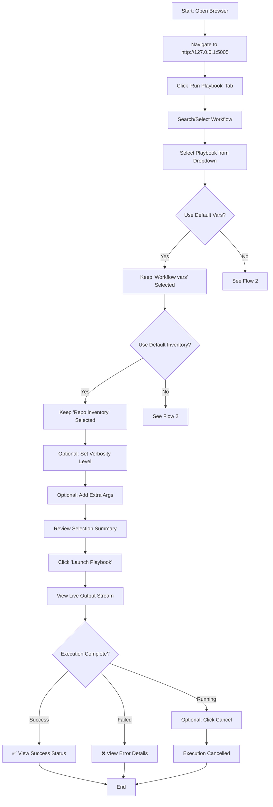
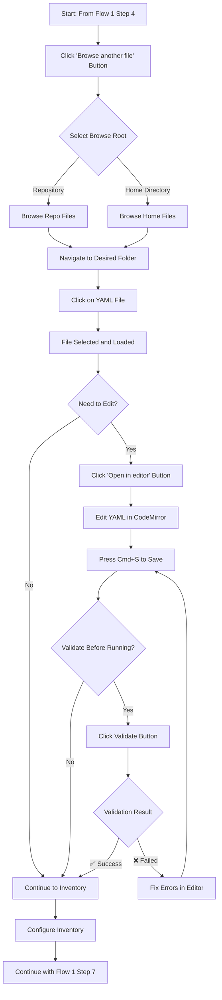
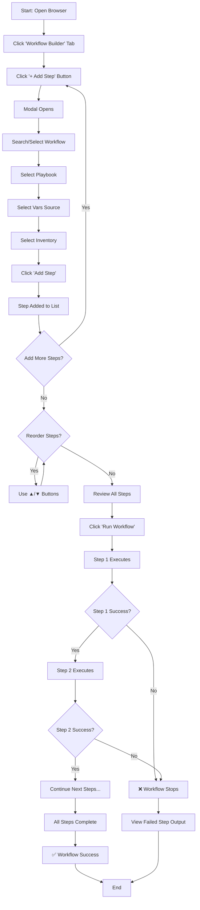
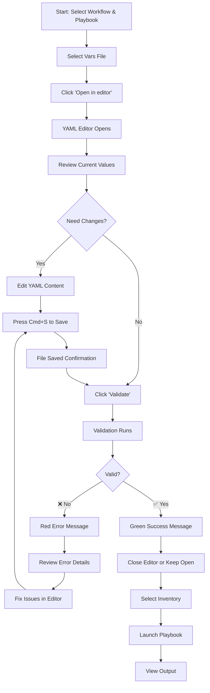

# Ansible Workflow Runner

A lightweight web UI for browsing, editing, and executing Ansible playbooks from the `dnac_ansible_workflows` repository.

Linux startup templates and preflight checks are in [Linux Preparation](deploy/README.md).
They configure a private backend only; HTTPS and team-access port configuration
are a separate deployment step.

Login is required. Initialize an administrator before starting the runner;
see [Login and Permissions](AUTHENTICATION.md) for setup, roles, and deployment
limitations. Shared server access requires HTTPS and a single runner process.

Use the sun/moon icon at the top of the page to switch between light and dark themes.
Light is the default; the choice is remembered in this browser and shared across
the dashboard, login screen and job detail pages. Execution and permissions are
unaffected by theme selection.

## Table of Contents

- [Features](#features)
- [Prerequisites](#prerequisites)
- [Quick Start](#quick-start)
- [User Flows](#user-flows)
  - [Flow 1: Run a Playbook with Default Settings](#flow-1-run-a-playbook-with-default-settings)
  - [Flow 2: Run a Playbook with Custom Vars](#flow-2-run-a-playbook-with-custom-vars)
  - [Flow 3: Build and Execute a Multi-Step Workflow](#flow-3-build-and-execute-a-multi-step-workflow)
  - [Flow 4: Validate and Edit Vars Before Running](#flow-4-validate-and-edit-vars-before-running)
- [Architecture](#architecture)
- [API Reference](#api-reference)
- [Keyboard Shortcuts](#keyboard-shortcuts)

---

## Features

- **🚀 Run Playbook** — Select workflow and playbook, then launch with repo defaults or custom file paths
- **📝 YAML Editor** — Load and edit vars files in-browser with syntax highlighting (CodeMirror)
- **✅ Schema Validation** — Validate repo or custom vars files against their schema before running
- **📂 Custom File Browser** — Browse YAML vars or inventory files from the repo or your home directory
- **📡 Live Output** — Stream ansible-playbook output in real time with ANSI color support
- **🔗 Workflow Builder** — Chain multiple playbook runs into a sequential workflow; reorder steps with up/down controls
- **📊 Job History** — View past executions with status, duration, timestamps, and clickable detailed log links
- **📄 Job Detail Pages** — Open a shareable page for a single job with full Ansible output and raw log access
- **🛑 Cancel Support** — Stop running playbooks or entire workflows mid-execution

---

## Shared Saved Suites

Saved suite definitions now use the same protected SQLite database as history,
not browser localStorage. All signed-in users can view them. Operators can create
suites and update/delete their own; Admins can manage any suite and change the
shared ordering. Other Operators can load a copy without changing the original.
Edits and deletes use revisions to reject stale changes from another session.
Use Refresh or reopen Automation Suites to fetch the current shared list.

Suite definitions store file/repository references and non-secret controller
details only. Passwords are never saved in definitions. Load the suite and enter
current credentials in Catalyst Center targets before running. Existing matching
credentials entered in the current page are reused. Input repositories must
already be fetched on the runner server; loading retrieves their file catalog
without a new clone or fetch. Missing repos require an administrator to fetch them.

To migrate old browser suites, choose **Import browser suites** while signed in
as Operator or Admin. Confirm sharing with the team. Successfully imported entries
are removed from that browser's old list; failed entries remain for retry.
Import retries are idempotent per account and browser suite ID and never overwrite
an already imported shared definition. Browser storage is not a fallback if the
server database is unavailable. Export/backup old suites before clearing browser
data or switching to a different server origin; a new origin cannot read the old
browser storage. Shared definitions do not migrate Mac-specific file paths or Git
checkouts onto Linux automatically.

Deleting a saved definition removes the shared template, not its past run history
or a running launch. History/log deletion remains a separate Assurance action.
Restart the runner after this upgrade to create the saved-suites table.

## Persistent History

### Catalyst Center Lookup Destinations

Set `RUNNER_CATC_ALLOWED_HOSTS` on the server to a comma-separated list of
approved Catalyst Center hostnames/IPs (optional explicit ports). Admin-saved
controller profiles and `HOSTIP`, if configured by the administrator, are also
approved. UI interface/port lookups
cannot contact other hosts, follow redirects, or use environment HTTP proxies.
These lookups verify TLS certificates: install the lab CA in the service's
trust store, or set `SSL_CERT_FILE` to its PEM CA bundle. This restriction applies
to backend lookups, not arbitrary Ansible workflows run by trusted Operators.

### Saved Controller Connections

Admins can enter each target once under Run and click **Save connection**.
Passwords are encrypted with Fernet in `controllers.sqlite3`, next to the runner
account file. The encryption key is a separate `controllers.key` file; both files
are mode 0600 within the protected authentication directory. Passwords are never
returned by the profile API or saved in suite JSON/browser storage. The UI shows
**Credential saved** and loads available connections again on login/reload.

Connections are shared with this trusted team: Operators may execute against all
saved connections, Viewers can see connection metadata but cannot execute, and
only Admins may create/update/delete connections. Per-profile user grants are
not implemented. Saving a profile approves its host for backend lookups; only
approve known Catalyst Center destinations, not arbitrary user-supplied URLs.
Certificate verification for backend lookups still requires trusted certificates.

Each suite stores its selected profile ID. Save changed credentials before
launching. Existing suites with matching name/host/username/TLS settings can use
a saved connection without retyping its password; save the suite again to retain
the ID explicitly. Deleted or changed connections fail before dispatch rather
than falling back to another controller. Jobs already accepted retain the
credentials resolved at submission, so deletion does not cancel running work.

Protect and back up the key separately from the credential database. Losing it
makes stored credentials unreadable; the runner will not silently regenerate a
missing key while its credential database exists. Encryption does not protect
against a compromised service account able to read both files. No server setup
command is needed for key creation: the store is initialized on first use.

Job metadata is stored in SQLite and output in protected JSON-lines log files.
The default directory is `~/.local/share/catalystcenter-runner`, outside the Git
checkout. Set `RUNNER_HISTORY_DIR` to a dedicated writable directory owned by the
runner service account on Linux (for example `/var/lib/catalystcenter-runner`).
Directories use mode 0700; the database and logs use mode 0600. Logs may contain
sensitive workflow output: protect this directory and its backups accordingly.
Execution credentials and arbitrary command arguments are not saved as job
metadata. History is not a replay queue.

Public job responses show only a command summary, not raw extra arguments.
Known input/environment credentials and common secret patterns are redacted
before output is stored. Older logs are pattern-redacted when loaded. This is
best-effort protection, not a guarantee that arbitrary workflow output is safe
to share; all runner accounts must still be trusted.

History and logs survive a runner restart. Running and queued plays become
`interrupted`; nothing is automatically rerun. A child Ansible process can outlive
the web process: verify Catalyst Center before retrying. If the previous process
still exists, deletion stays blocked until it exits. This conservative check can
also block a reused process ID; an administrator must verify the situation.
Previously completed/failed/cancelled jobs keep their results. All selected suite
plays are recorded before execution starts; plays skipped by a stop policy are
marked `not-run`.

Automation Assurance offers **Delete play** and **Delete suite**, with permanent
deletion confirmation. Viewers cannot delete; Operators can delete their own
finished runs; Admins can delete any finished run. Active plays and active suites
cannot be deleted. Removing a suite removes all its saved plays and logs. Removing
one play updates the remaining suite's plan and counts. Deletion does not undo
network changes or remove copies in external backups. There is no automatic
retention purge in this version; monitor disk space and delete unwanted history.
Deletion intent is saved before removing files. If storage permissions prevent
cleanup, fix them and retry, or restart to resume the pending deletion. Job
metadata is retained until file cleanup succeeds.

The network devices information playbook automatically waits for inventory
readiness for explicit IP queries, using each query's timeout, retries and
interval (defaults: 120 seconds, 3 retries, 10 seconds). All requested IPs must
be ready before information gathering starts. Timeout is checked after each
response, so an in-flight request and polling delay can extend elapsed time.
Hostname, serial and site queries retain their existing behavior. An explicit
`network_devices_info_wait_for_readiness=false` remains available for diagnostic
information-only IP lookups; onboarding suites should not disable readiness.

Automation Assurance offers **Rerun play** for failed plays once their suite and
processes have stopped, for the run owner or an administrator. It loads only
that play directly as a new standalone job with one click; it does not open Run,
save a suite, or resume at the failed task. Original logs remain unchanged and
the retry records its original job ID. Current input files at the recorded source
paths and current credentials from the same saved controller profile are used.
This also restarts destructive playbooks: clicking Rerun is an execution action.
Missing files/profiles or changed controller identity block execution. Runs with
extra arguments must be launched manually because those arguments are not stored.
Older history uses a uniquely matching saved-suite entry when available;
missing or ambiguous source information blocks rerun. An active retry is reused
on duplicate requests rather than launching another process.

Keep **one runner process** per history directory. Multiple workers/processes and
automatic job resumption are not supported. Back up the SQLite database and logs
together while the runner is stopped. Old runs held only in memory by a previous
version cannot be recovered after that version exits. Restarting to upgrade will
not migrate those in-memory runs automatically.

## Input Files

### Shared Git Repository Catalog

Successful Add repo requests persist the URL, branch/ref, commit, cache ID and
input file catalog in SQLite alongside job history. Every signed-in user loads
the shared catalog from the server after login/reload. Only the selected repo ID
is browser-session-specific; one person's selection does not switch another's.
Admins fetch, refresh and remove shared entries; other users can select them.
Repository URLs containing credentials, query strings or fragments are rejected.
Private Git authentication remains a service-account configuration, not saved
browser credentials.

Adding an already registered repository/ref reuses the saved snapshot. Explicit
Refresh creates a new snapshot and updates the catalog; old snapshots remain for
existing suite/job references. Simultaneous requests for the same repository/ref
return a conflict rather than launching duplicate clones. Failed refreshes leave
the previous successful entry intact. Different branches/repos stay independent.
These locks require the documented single-worker deployment.

Remove unregisters a shared catalog entry after confirmation, but does not delete
its cache directory or alter saved suites. Missing cache directories are shown as
unavailable; an administrator can fetch them again. Cache cleanup/retention is
not automatic. Back up both the SQLite database and `.runner_repos` directory.
Repos fetched before this catalog feature must be added once after upgrading;
the old cache alone did not record enough catalog metadata for automatic import.

The runner accepts a separate inventory plus workflow vars, or a single vars
file with a top-level `inventory` mapping. For a combined file, leave the
Inventory selection empty ("From vars file"). For example:

```yaml
inventory:
  all:
    children:
      catalyst_center_hosts:
        hosts:
          catalyst_center:
            ansible_connection: local
            catalyst_center_host: "<catalyst-center-host>"
            catalyst_center_username: "<username>"
            catalyst_center_password: "<password>"

provision_details:
  - management_ip_address: "192.0.2.10"
    site_name_hierarchy: "Global/Lab"
    provisioning: true
```

Validate checks workflow inputs against the selected schema and checks the
embedded inventory structure separately. Customize inputs edits the same vars
file. A selected separate inventory takes precedence over embedded inventory.
Combined runs create a protected temporary inventory only during execution and
remove it afterward. The original vars file is passed through `VARS_FILE_PATH`.

## Review Regression Checks

Run from the repository root, using the runner's Python environment:

```bash
python -m unittest discover -s tools/ansible_runner/tests -v
node tools/ansible_runner/tests/test_embedded_inventory_ui.cjs
node tools/ansible_runner/tests/test_review_regressions_ui.cjs
```

These cover both inventory formats, repository-specific editing, unsaved input
guards, completion callback status, queued/running cancellation, suite stopping,
and path confinement. Run plans expose Stop suite while launching; Automation
Assurance also provides Stop play and Stop suite. Cancellation stops local
execution but does not roll back changes already submitted to Catalyst Center.

Git inputs never fall back to another repository's same-named file. Unexpected
server exceptions are logged locally rather than returned to browser clients.

## Prerequisites

Before running the Ansible Workflow Runner, ensure you have:

- **Python 3.9+** installed
- **Ansible** installed and `ansible-playbook` in your PATH
- **Flask** and **Yamale** Python packages (installed via requirements.txt)
- A configured **inventory file** (e.g., `inventory/demo_lab/hosts.yaml`)
- Access to the **dnac_ansible_workflows** repository

---

## Quick Start

```bash
# Navigate to the repository root
cd /path/to/dnac_ansible_workflows

# Create a virtual environment (recommended)
python3 -m venv tools/ansible_runner/.venv

# Activate the virtual environment
source tools/ansible_runner/.venv/bin/activate  # On macOS/Linux
# OR
tools\ansible_runner\.venv\Scripts\activate     # On Windows

# Install dependencies
pip install -r tools/ansible_runner/requirements.txt

# Initialize a local administrator (prompts for a password)
python tools/ansible_runner/manage_users.py init admin

# Start for localhost HTTP development only; shared servers must use HTTPS
RUNNER_COOKIE_SECURE=false python tools/ansible_runner/app.py

# Open in browser
open http://127.0.0.1:5005
```

**Alternative Quick Start (using existing Python):**
```bash
cd /path/to/dnac_ansible_workflows
pip install flask yamale
python tools/ansible_runner/manage_users.py init admin
RUNNER_COOKIE_SECURE=false python tools/ansible_runner/app.py
```

---

## User Flows

### Flow 1: Run a Playbook with Default Settings

**Use Case:** Execute a workflow playbook using the default vars and inventory files from the repository.



**Step-by-Step Instructions:**

1. **Open the Application**
   - Navigate to `http://127.0.0.1:5005` in your browser
   - You'll see the main dashboard with workflow statistics

2. **Select Workflow**
   - Click the **"Run Playbook"** tab
   - Use the search box to filter workflows (e.g., type "network_settings")
   - Select your desired workflow from the dropdown

3. **Select Playbook**
   - The playbook dropdown auto-populates with available playbooks
   - Select the playbook you want to run

4. **Configure Vars (Default)**
   - Keep **"Workflow vars"** button selected (default)
   - The default vars file from the workflow will be used

5. **Configure Inventory (Default)**
   - Keep **"Repo inventory"** button selected (default)
   - Select an inventory file from the dropdown (e.g., `inventory/demo_lab/hosts.yaml`)

6. **Optional Settings**
   - Set **Verbosity**: Choose from `-v`, `-vv`, `-vvv`, `-vvvv` for more detailed output
   - Add **Extra Arguments**: e.g., `--check --diff` for dry-run mode

7. **Launch**
   - Review the selection summary at the bottom
   - Click **"Launch playbook"**
   - Watch the live output stream with color-coded Ansible output

8. **Monitor Execution**
   - View real-time output in the terminal section
   - Status badge shows: Running → Completed/Failed
   - Click **"Cancel"** if needed to stop execution

---

### Flow 2: Run a Playbook with Custom Vars

**Use Case:** Execute a workflow playbook using a custom vars file from your home directory or a different location.



**Step-by-Step Instructions:**

1. **Switch to Custom Vars**
   - After selecting workflow and playbook, click **"Browse another file"** under Vars File Source

2. **Browse for File**
   - Choose browse root: **Repository** or **Home**
   - Navigate through folders by clicking on directory names
   - Use breadcrumbs at the top to go back to parent folders
   - Click on a YAML file to select it

3. **Edit Vars (Optional)**
   - Click **"Open in editor"** button next to the selected file
   - The YAML editor opens with syntax highlighting
   - Make your changes
   - Press `Cmd+S` (Mac) or `Ctrl+S` (Windows/Linux) to save

4. **Validate Vars (Recommended)**
   - Click the **"✓ Validate"** button
   - If validation passes: ✅ Green success message
   - If validation fails: ❌ Red error message with details
   - Fix any errors and save again

5. **Continue with Inventory**
   - Select inventory (default or browse for custom)
   - Proceed to launch as in Flow 1

---

### Flow 3: Build and Execute a Multi-Step Workflow

**Use Case:** Chain multiple playbook executions into a sequential workflow (e.g., configure network settings, then deploy fabric, then verify).



**Step-by-Step Instructions:**

1. **Open Workflow Builder**
   - Click the **"Workflow Builder"** tab

2. **Add First Step**
   - Click **"+ Add Step"**
   - In the modal:
     - Search/select workflow
     - Select playbook
     - Choose vars source (workflow default or browse)
     - Select inventory
   - Click **"Add Step"**

3. **Add More Steps**
   - Repeat step 2 for each playbook you want to run
   - Steps will execute in the order they appear

4. **Reorder Steps (Optional)**
   - Use **▲** button to move a step up
   - Use **▼** button to move a step down
   - Use **✕** button to remove a step

5. **Execute Workflow**
   - Review all steps in the list
   - Click **"Run Workflow"**
   - Each step executes sequentially
   - If any step fails, the workflow stops
   - View combined output in the terminal below

6. **Monitor Progress**
   - Each step shows status: ⏳ Pending → 🔄 Running → ✅ Completed / ❌ Failed
   - Click **"Cancel Workflow"** to stop execution
   - Remaining steps will be marked as ⚪ Cancelled

---

### Flow 4: Validate and Edit Vars Before Running

**Use Case:** Review and modify vars file, validate against schema, then execute playbook.



**Step-by-Step Instructions:**

1. **Load Vars in Editor**
   - After selecting workflow, playbook, and vars file
   - Click **"Open in editor"** button (📝 icon)
   - The CodeMirror editor opens with YAML syntax highlighting

2. **Review and Edit**
   - Review the current configuration
   - Make necessary changes (e.g., update IP addresses, credentials, settings)
   - The editor shows line numbers and auto-indents

3. **Save Changes**
   - Press `Cmd+S` (Mac) or `Ctrl+S` (Windows/Linux)
   - Or click the **"Save"** button in the editor header
   - Toast notification confirms save

4. **Validate Against Schema**
   - Click the **"✓ Validate"** button
   - The system runs Yamale validation against the workflow's schema
   - Results appear below the vars file selector

5. **Handle Validation Results**
   - **✅ Success**: Green message "Validation completed"
   - **❌ Failure**: Red message with specific errors
     - Example: `line 15: 'ip_address' is required`
     - Fix the errors in the editor
     - Save and validate again

6. **Proceed to Launch**
   - Once validation passes, continue with inventory selection
   - Launch the playbook with confidence

---

## Architecture

```
tools/ansible_runner/
├── app.py              # Flask backend — API + process management
├── requirements.txt    # Python dependencies (flask, yamale)
├── README.md           # This file
├── .venv/              # Virtual environment (created by user)
└── templates/
    ├── index.html      # Main runner frontend (Tailwind + CodeMirror)
    └── job.html        # Dedicated job log page
```

### Backend (`app.py`)
- **Workflow Discovery**: Scans `workflows/` directory for playbooks, vars, schemas
- **File Browser**: Serves YAML files from repo and home directory with path validation
- **File Operations**: Read/write YAML files with security checks
- **Schema Validation**: Uses Yamale to validate vars against workflow schemas
- **Process Management**: Runs `ansible-playbook` via subprocess with live streaming
- **Job Tracking**: Manages job lifecycle (queued → running → completed/failed/cancelled)
- **SSE Streaming**: Server-Sent Events for real-time output with ANSI color preservation

### Frontend (`index.html`)
- **Single HTML File**: No build step required, runs directly in browser
- **Tailwind CSS**: Modern UI styling via CDN
- **CodeMirror 5**: YAML editor with syntax highlighting via CDN
- **Vanilla JavaScript**: All interactivity without frameworks
- **Three Main Tabs**:
  1. **Run Playbook**: Single playbook execution with guided form
  2. **Workflow Builder**: Multi-step workflow creation and execution
  3. **Job History**: View past executions with status, timing, and direct log links

---

## API Reference

| Method | Endpoint | Description |
|--------|----------|-------------|
| `GET` | `/` | Serve the main HTML interface |
| `GET` | `/jobs/<id>` | Serve the dedicated job detail page |
| `GET` | `/api/workflows` | List all workflow directories with their playbooks, vars, and schemas |
| `GET` | `/api/inventories` | List all inventory YAML files from `inventory/` directory |
| `GET` | `/api/fs?root=<repo\|home>&path=<path>` | Browse YAML files under the repo or home directory |
| `GET` | `/api/file?path=<rel>` | Read a file's content (repo or home directory) |
| `PUT` | `/api/file` | Save file content: `{path, content}` |
| `POST` | `/api/validate` | Validate vars against schema: `{schema, data}` |
| `POST` | `/api/run` | Start a playbook run: `{inventory, playbook, vars_file, verbosity, extra_args, label}` |
| `GET` | `/api/run/<id>/stream` | SSE stream of job output (real-time, supports `start=<line>` offset) |
| `POST` | `/api/run/<id>/cancel` | Cancel a running job |
| `GET` | `/api/jobs` | List all jobs with status, duration, and timing |
| `GET` | `/api/jobs/<id>` | Get a single job with metadata and captured log lines |
| `GET` | `/api/jobs/<id>/log` | Open the captured job log as plain text |

---

## Keyboard Shortcuts

| Shortcut | Action |
|----------|--------|
| `Cmd+S` / `Ctrl+S` | Save the file currently open in the editor |
| `Escape` | Close modal dialogs |
| `Cmd+1` / `Ctrl+1` | Switch to Run Playbook tab |
| `Cmd+2` / `Ctrl+2` | Switch to Workflow Builder tab |
| `Cmd+3` / `Ctrl+3` | Switch to Job History tab |

---

## Troubleshooting

### Server won't start
- **Issue**: `ModuleNotFoundError: No module named 'flask'`
- **Solution**: Install dependencies: `pip install -r tools/ansible_runner/requirements.txt`

### Ansible playbook not found
- **Issue**: `ansible-playbook: command not found`
- **Solution**: Install Ansible: `pip install ansible` or `brew install ansible`

### Validation fails
- **Issue**: Schema validation errors
- **Solution**: Review the error message, fix the vars file, and validate again

### Can't access custom files
- **Issue**: "Access denied" when browsing files
- **Solution**: Ensure files are within the repository or your home directory

---

## License

This tool is part of the `dnac_ansible_workflows` repository. Refer to the main repository license.
